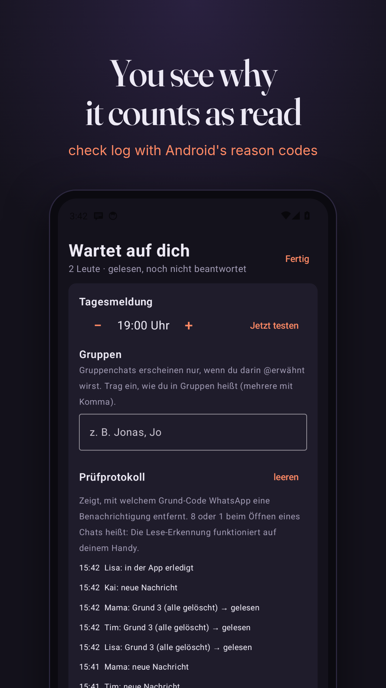

<p align="center"></p>

<h1 align="center">Antwort-Radar: reply reminder for WhatsApp on Android, for people who read a message and forget to answer (ADHD-friendly)</h1>

<p align="center"><strong>Antwort-Radar notices when you open a WhatsApp chat and then don't reply. It keeps a short list of who is waiting for you and how long, and sends one reminder a day. No typing anything in, no account, no internet permission. Open source, runs on GrapheneOS.</strong></p>

<p align="center">
  <a href="https://kotlinlang.org/"></a>
  <br>
  <a href="#install"></a>
  <a href="#install"></a>
  <a href="#privacy"></a>
  <a href="https://developer.android.com/compose"></a>
  <a href="https://github.com/BrickyStudios/antwort-radar/actions/workflows/ci.yml"></a>
  <a href="LICENSE"></a>
  <a href="https://github.com/BrickyStudios/antwort-radar/commits/main"></a>
</p>

<p align="center">
  <a href="https://github.com/BrickyStudios/antwort-radar/releases/latest/download/AntwortRadar.apk"></a>
  <a href="https://brickystudios.github.io/antwort-radar/"></a>
</p>

<p align="center">
  <a href="#install">Install</a> ·
  <a href="#how-it-works">How it works</a> ·
  <a href="#privacy">Privacy</a> ·
  <a href="#limits">Limits</a> ·
  <a href="#build-it-yourself">Build</a> ·
  <a href="#auf-deutsch">Deutsch</a>
</p>

You open a chat, read it, write the answer in your head, put the phone down, and never send it. WhatsApp only marks a chat unread until you open it, so after that it's off the radar. With ADHD this happens all the time, and friends read the silence as "doesn't care". Threads like [this one on r/ADHD](https://www.reddit.com/r/ADHD/comments/1wm31ed/) (1,300+ upvotes, "I ruined an old friendship") are full of people who lost someone this way.

Antwort-Radar ("reply radar") catches the moment it happens. When WhatsApp removes its notification because you opened the chat, the chat goes on a list: **read, not answered**. It stays there until you reply or swipe it away.

<p align="center">
  
  
</p>

## Install

1. Download [`AntwortRadar.apk`](https://github.com/BrickyStudios/antwort-radar/releases/latest/download/AntwortRadar.apk) and open it (Android 8.0 or newer).
2. Tap **Zugriff erlauben** and switch on notification access for Antwort-Radar. Without it the app can't see when a chat was opened.
3. Updates: add `https://github.com/BrickyStudios/antwort-radar` to [Obtainium](https://github.com/ImranR98/Obtainium). The app has no internet permission, so it can't update itself.

## How it works

| You do this | Antwort-Radar does this |
|---|---|
| Someone writes you on WhatsApp | Notes the chat as unread (greyed out, WhatsApp shows these anyway) |
| You open the chat, tap or swipe the notification | Moves it to **Wartet auf dich** (waiting for you), with the time you read it |
| You reply straight from the notification | Sees your message in the notification and marks the chat done |
| You reply inside WhatsApp | Swipe the entry away. Android gives apps no signal for messages you send in WhatsApp itself |
| Someone waits more than 2 days | The entry gets a heavy border, no red alarm colours |
| 19:00 (you pick the hour) | One notification: "3 Leute warten auf dich: Mama (3 T), Lisa (2 T), Tim (5 Std)" |

<p align="center"></p>

**Groups** only show up when someone @-mentions you. Enter the name you have in your groups in the settings; without it, group chats are ignored so the list doesn't fill up with class and team chats.

**Check log.** Phones and WhatsApp versions differ in how they remove notifications. The settings show the last 50 events with Android's reason code (`8` = WhatsApp removed it, `1` = tapped, `2` = swiped). If opening a chat on your phone shows up as 8 or 1, read detection works for you.

## Privacy

- **No internet permission.** Check it yourself: `aapt dump permissions AntwortRadar.apk` lists only `POST_NOTIFICATIONS`.
- Only WhatsApp (`com.whatsapp`, `com.whatsapp.w4b`) is read. Every other app's notifications are skipped in the first line of the listener.
- Stored per chat: name, times, the first 80 characters of the last message. All in one file in the app's private storage, excluded from cloud backup and device transfer.
- No analytics, no crash reporting, no Google libraries beyond AndroidX.

## Limits

- **WhatsApp only** in v0.1. Signal, Telegram and SMS use the same Android notification format and are next.
- Messages that arrive while the chat is open on screen never create a notification, so the radar doesn't see them.
- "Answered" is only detected when you reply from the notification. Replies typed in WhatsApp need a swipe.
- Tapping an entry opens WhatsApp, not the exact chat: WhatsApp's chat links need a phone number, and the notification doesn't carry one.
- The app is German for now. English strings are planned.

## Build it yourself

```bash
git clone https://github.com/BrickyStudios/antwort-radar && cd antwort-radar
JAVA_HOME=/path/to/jdk-17 ./gradlew testDebugUnitTest assembleDebug
```

The state machine lives in [`Radar.kt`](app/src/main/java/io/github/brickystudios/antwortradar/Radar.kt) as plain functions with [unit tests](app/src/test/java/io/github/brickystudios/antwortradar/RadarTest.kt). Debug builds also track notifications from `com.android.shell`, so you can test on an emulator without WhatsApp:

```bash
adb shell "cmd notification post -S messaging --conversation 'Lisa' --message 'Lisa:Hast du die Aufgaben?' chat_lisa x"
```

Release APKs are built and signed by GitHub Actions when a `v*` tag is pushed.

## Auf Deutsch

Du liest eine WhatsApp, antwortest im Kopf und schickst nie ab. Antwort-Radar merkt, wenn die WhatsApp-Benachrichtigung verschwindet, weil du den Chat geöffnet hast, und setzt den Chat auf die Liste **Wartet auf dich**. Dort steht, wer seit wann auf dich wartet. Wischen heißt erledigt. Einmal am Tag zu deiner Uhrzeit kommt eine Sammelmeldung, nie eine pro Nachricht.

- Ohne Internet-Berechtigung, ohne Konto, läuft auf GrapheneOS
- Gruppen nur, wenn du @erwähnt wirst
- Prüfprotokoll in den Einstellungen zeigt, ob die Lese-Erkennung auf deinem Handy klappt (Grund 8 oder 1 beim Öffnen eines Chats)
- [APK herunterladen](https://github.com/BrickyStudios/antwort-radar/releases/latest/download/AntwortRadar.apk), Updates über Obtainium

## License

[GPL-3.0](LICENSE). Not affiliated with WhatsApp or Meta.
