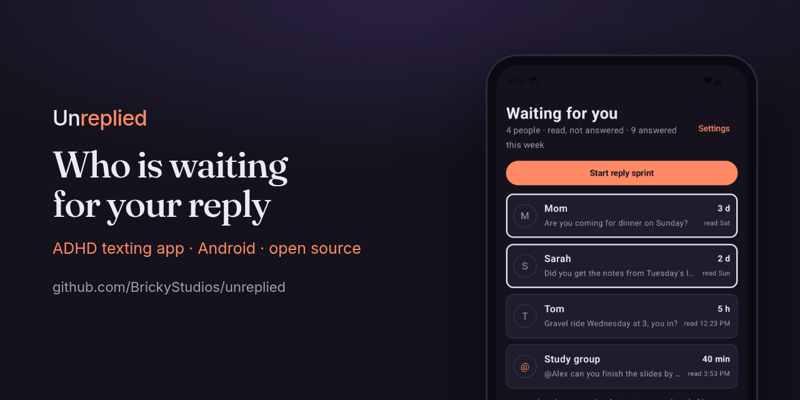
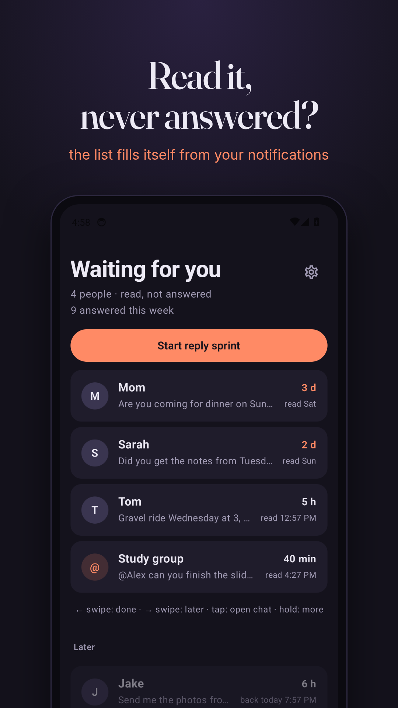
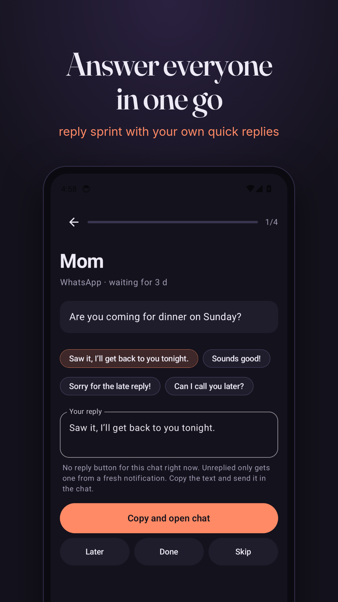
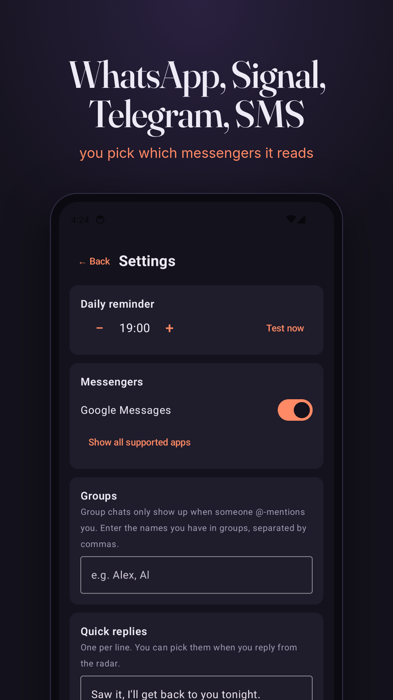
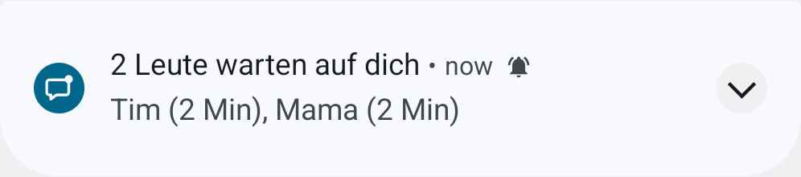

<p align="center"></p>

<h1 align="center">Unreplied: ADHD texting app that reminds you to text back on WhatsApp, Signal, Telegram and SMS (Android, open source)</h1>

<p align="center"><strong>Read a message, answered it in your head, never sent it? Unreplied notices when you open a chat and don't reply, keeps a list of unanswered texts and who has waited how long, lets you text everyone back in one reply sprint, and sends one reminder a day. No typing anything in, no account, no internet permission. Free, open source, English and German, runs on GrapheneOS.</strong></p>

<p align="center">
  <a href="https://kotlinlang.org/"></a>
  <br>
  <a href="#install"></a>
  <a href="#install"></a>
  <a href="#messengers"></a>
  <a href="#privacy"></a>
  <a href="https://developer.android.com/compose"></a>
  <a href="https://github.com/BrickyStudios/unreplied/actions/workflows/ci.yml"></a>
  <a href="LICENSE"></a>
  <a href="https://github.com/BrickyStudios/unreplied/commits/main"></a>
</p>

<p align="center">
  <a href="https://github.com/BrickyStudios/unreplied/releases/latest/download/Unreplied.apk"></a>
  <a href="https://brickystudios.github.io/unreplied/"></a>
</p>

<p align="center">
  <a href="#install">Install</a> ·
  <a href="#how-it-works">How it works</a> ·
  <a href="#messengers">Messengers</a> ·
  <a href="#privacy">Privacy</a> ·
  <a href="#limits">Limits</a> ·
  <a href="#build-it-yourself">Build</a> ·
  <a href="#auf-deutsch">Deutsch</a>
</p>

You open a chat, read it, write the answer in your head, put the phone down, and never send it. WhatsApp only marks a chat unread until you open it, so after that it's off the radar. With ADHD this happens all the time, and friends read the silence as "doesn't care". Threads like [this one on r/ADHD](https://www.reddit.com/r/ADHD/comments/1wm31ed/) (1,300+ upvotes, "I ruined an old friendship") are full of people who lost someone this way.

Unreplied catches the moment it happens. It started as Antwort-Radar (German for "reply radar"). When your messenger removes its notification because you opened the chat, the chat goes on a list: **read, not answered**. It stays there until you reply, swipe it away or push it to later.

<p align="center">
  
  
  
</p>

## Install

1. Download [`Unreplied.apk`](https://github.com/BrickyStudios/unreplied/releases/latest/download/Unreplied.apk) and open it (Android 8.0 or newer).
2. Tap **Allow access** and switch on notification access for Unreplied. If the switch is greyed out, open the app info, tap ⋮ and choose *Allow restricted settings* (Android 13+ asks this for apps installed from a file).
3. Optional: add the widget to your home screen and the tile to your quick settings.
4. Updates: add `https://github.com/BrickyStudios/unreplied` to [Obtainium](https://github.com/ImranR98/Obtainium). The app has no internet permission, so it can't update itself.

## How it works

| You do this | Unreplied does this |
|---|---|
| Someone writes you | Notes the chat as unread (greyed out, your messenger shows these anyway) |
| You open the chat, tap or swipe the notification | Moves it to **Waiting for you**, oldest first, with the time you read it |
| You reply straight from the notification | Sees your message in the notification and marks the chat done |
| You reply inside the messenger | Swipe the entry left. Android gives apps no signal for messages you send in the messenger itself |
| Not now | Swipe right (3 hours), or hold for "tonight" and "tomorrow morning". The chat comes back on its own |
| Several people waiting | **Reply sprint**: one person at a time, pick a quick reply, send, next. Shows "2 of 5" |
| Someone waits more than 2 days | The entry gets a heavy border, no red alarm colours |
| 19:00 (you pick the hour) | One notification: "3 people are waiting for you: Mom (3 d), Sarah (2 d), Tom (5 h)" |

**Reply without switching apps.** While Unreplied holds a chat's notification, it can send your text through the messenger's own reply button, and tapping the entry opens that exact chat. When the button is gone (for example after a phone restart), the sprint copies your text and opens the messenger instead.

**Quick replies.** Four defaults ("Saw it, I'll get back to you tonight.", "Sounds good!", ...), editable in the settings. Having a few sentences ready is a tip from the [r/ADHD thread](https://www.reddit.com/r/ADHD/comments/1wm31ed/) that started this app.

**Staying in touch.** Hold a chat and mark the person as favorite. If no message goes back or forth for 3 weeks (you pick 1 to 26), they show up under **Haven't written in a while** and in the daily reminder.

**Groups** only show up when someone @-mentions you. Enter the names you have in your groups in the settings. **Ignore** a chat by holding it; the settings list ignored chats so you can bring them back.

**Widget and quick-settings tile** show how many people are waiting, on the home screen and in the notification shade.

<p align="center"></p>

**Check log.** Phones and messengers differ in how they remove notifications. The settings show the last 50 events with Android's reason code (`8` = the app removed it, `1` = tapped, `2` = swiped). If opening a chat shows up as 8 or 1, read detection works on your phone.

## Messengers

On by default: WhatsApp, WhatsApp Business, Signal, Molly, Telegram, Telegram X, Threema, Google Messages, Fossify SMS, QKSMS. Off by default because their notifications are untested: Instagram, Discord, Snapchat. The settings show the ones installed on your phone, each with its own switch.

## Privacy

- **No internet permission.** Check it yourself: `aapt dump permissions Unreplied.apk` lists only `POST_NOTIFICATIONS`.
- Only the messengers you switch on are read. Every other app's notifications are skipped in the first check of the listener.
- Stored per chat: name, times, the first 80 characters of the last message. All in one file in the app's private storage, excluded from cloud backup and device transfer. **Delete all data** in the settings wipes it.
- No analytics, no crash reporting, no Google libraries beyond AndroidX.

## Limits

- Read detection is tested on an emulator, not yet with every messenger on real phones. The check log tells you how yours behaves; please [open an issue](https://github.com/BrickyStudios/unreplied/issues) with the codes you see.
- Messages that arrive while the chat is open on screen never create a notification, so Unreplied doesn't see them.
- "Answered" is only detected when you reply from the notification or from Unreplied. Replies typed in the messenger need a swipe.
- Reply buttons and "open this exact chat" live in memory. After a phone restart they come back with the next notification of that chat.
- Android 13+ blocks notification access for apps installed from a file until you allow restricted settings in the app info. The app explains the steps.

## Build it yourself

```bash
git clone https://github.com/BrickyStudios/unreplied && cd unreplied
JAVA_HOME=/path/to/jdk-17 ./gradlew testDebugUnitTest assembleDebug
```

The state machine lives in [`Radar.kt`](app/src/main/java/io/github/brickystudios/antwortradar/Radar.kt) as plain functions with [unit tests](app/src/test/java/io/github/brickystudios/antwortradar/RadarTest.kt). Debug builds also track notifications from `com.android.shell`, so you can test on an emulator without WhatsApp:

```bash
adb shell "cmd notification post -S messaging --conversation 'Lisa' --message 'Lisa:Hast du die Aufgaben?' chat_lisa x"
```

Release APKs are built and signed by GitHub Actions when a `v*` tag is pushed.

## Auf Deutsch

Unreplied (früher Antwort-Radar) ist eine WhatsApp-Erinnerung für unbeantwortete Nachrichten, gebaut für Menschen mit ADHS.

Du liest eine Nachricht, antwortest im Kopf und schickst nie ab. Unreplied merkt, wenn die Benachrichtigung verschwindet, weil du den Chat geöffnet hast, und setzt den Chat auf die Liste **Wartet auf dich**. Dort steht, wer seit wann auf dich wartet.

- Wischen nach links: erledigt. Nach rechts: später (kommt von selbst wieder)
- **Antwort-Sprint**: alle Wartenden nacheinander, mit eigenen Textbausteinen, direkt über den Antwort-Knopf des Messengers
- **Lange nicht geschrieben**: Favoriten, mit denen seit Wochen nichts lief
- WhatsApp, Signal, Telegram, Threema und SMS, jeder Messenger einzeln schaltbar
- Widget, Schnelleinstellungs-Kachel und eine Tagesmeldung zu deiner Uhrzeit, nie eine pro Nachricht
- Ohne Internet-Berechtigung, ohne Konto, App auf Deutsch und Englisch, läuft auf GrapheneOS
- [APK herunterladen](https://github.com/BrickyStudios/unreplied/releases/latest/download/Unreplied.apk), Updates über Obtainium

## License

[GPL-3.0](LICENSE). Not affiliated with WhatsApp or Meta.
